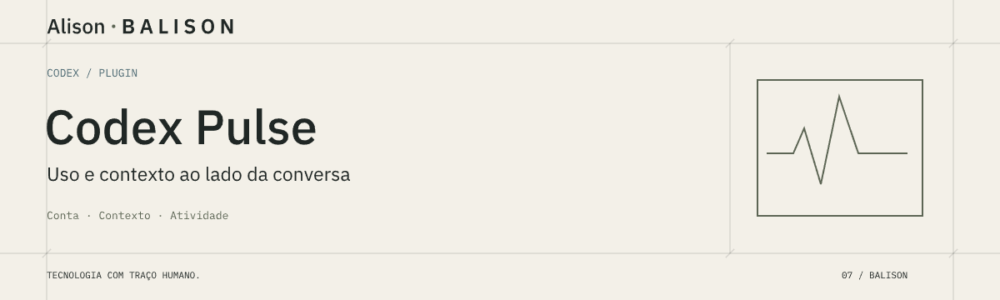

<h1 align="center">Codex Pulse</h1>

Uso da conta e contexto observado da conversa em um painel local.

  
  
  

  <a href="#começar-a-usar">Começar a usar</a> &nbsp; / &nbsp;
  <a href="#demonstração-e-recursos">Ver recursos</a> &nbsp; / &nbsp;
  <a href="#documentação-e-ajuda">Documentação</a>

---

## Sobre o projeto

O **Codex Pulse** é um plugin local para o Codex Desktop. Ele abre o painel **Uso restante** na lateral da conversa e reúne dados da janela de uso da conta, do contexto observado e da atividade registrada na conversa. Quando consegue correlacionar os registros locais com os metadados do host, também mostra consumo, tempo e etapas declaradas dos filhos diretos.

A interface é somente leitura: consulta os dados disponíveis, mas não inicia turnos de IA, interrompe agentes, compacta conversas nem cria sessões. Os valores de conta, ocupação do contexto e consumo acumulado representam medidas diferentes; tokens acumulados não são um preço.

## Demonstração e recursos

As imagens são ilustrações do painel com dados de exemplo, não capturas de uma execução real.

### O que aparece no painel

- **Uso da conta:** percentual consumido e restante da janela principal de cinco horas; o horário de renovação aparece quando recebido.
- **Contexto:** tokens e limite observados na resposta mais recente que pôde ser associada à conversa. Pode ficar indisponível enquanto não há metadados e registros correspondentes.
- **Atividade:** estado inferido de eventos locais reconhecidos. Sem evidência recente, o painel mostra indisponibilidade em vez de presumir que o agente está parado.
- **Filhos diretos:** contexto, consumo acumulado e etapas declaradas dos agentes vinculados à sessão atual. Não agrega netos nem outras conversas.

A conta é consultada pelo `codex app-server` autenticado. Para contexto e atividade, o plugin lê registros locais associados ao ID explícito da conversa enviado pelo host; não escolhe a conversa pela pasta aberta ou pela mais recente. As leituras são periódicas, em geral a cada 15 segundos, então eventos breves podem ocorrer entre atualizações. O plugin não envia esses registros a um backend do Codex Pulse.

## Começar a usar

### Requisitos

Use o Codex Desktop com suporte a plugins e abas MCP, o Codex CLI no `PATH`, Node.js 22 ou superior, uma conta autenticada no Codex e acesso local aos registros da conversa. Confira as versões no ambiente:

~~~powershell
node --version
codex --version
~~~

Se a CLI ainda não estiver autenticada, rode `codex login`. Depois, adicione o marketplace e instale o plugin:

~~~powershell
codex plugin marketplace add ba-lison/codex-pulse
codex plugin add usage-panel@codex-pulse
~~~

Encerre e reabra completamente o Codex Desktop. Na conversa, selecione **Uso restante** no painel lateral. A primeira leitura de contexto pode aparecer depois ou ficar indisponível quando o host não fornece os metadados e registros correlacionáveis. Não é necessário executar `npm install` para usar o plugin; as dependências npm do repositório servem ao gerador das imagens de documentação.

O plugin grava diagnósticos locais em `CODEX_HOME/usage-panel/diagnostics.jsonl` (ou `~/.codex/usage-panel/diagnostics.jsonl`). Esse arquivo pode conter o ID da conversa; confira-o antes de compartilhar.

## Documentação e ajuda

- [Arquitetura e origem dos dados](https://github.com/ba-lison/codex-pulse/blob/main/docs/architecture.md)
- [Validação registrada e ambiente observado](https://github.com/ba-lison/codex-pulse/blob/main/docs/validation.md)
- [Manifesto do plugin](https://github.com/ba-lison/codex-pulse/blob/main/plugins/usage-panel/plugin.json)
- [Guia técnico do pacote](https://github.com/ba-lison/codex-pulse/blob/main/plugins/usage-panel/README.md)

Para relatar um problema ou propor uma melhoria, [abra uma issue](https://github.com/ba-lison/codex-pulse/issues).

## Autoria e licença

Desenvolvido por [Alison Cruz](https://github.com/ba-lison) · **BALISON**.

Distribuído sob a [licença MIT](https://github.com/ba-lison/codex-pulse/blob/main/LICENSE).

---

  <a href="https://github.com/ba-lison">
    <picture>
      <source media="(prefers-color-scheme: dark)" srcset="assets/readme/assinatura-grafite.svg">
      
    </picture>
  </a>
   
  Tecnologia com traço humano.

