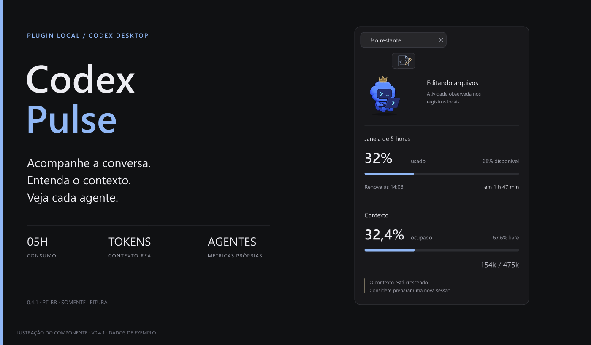
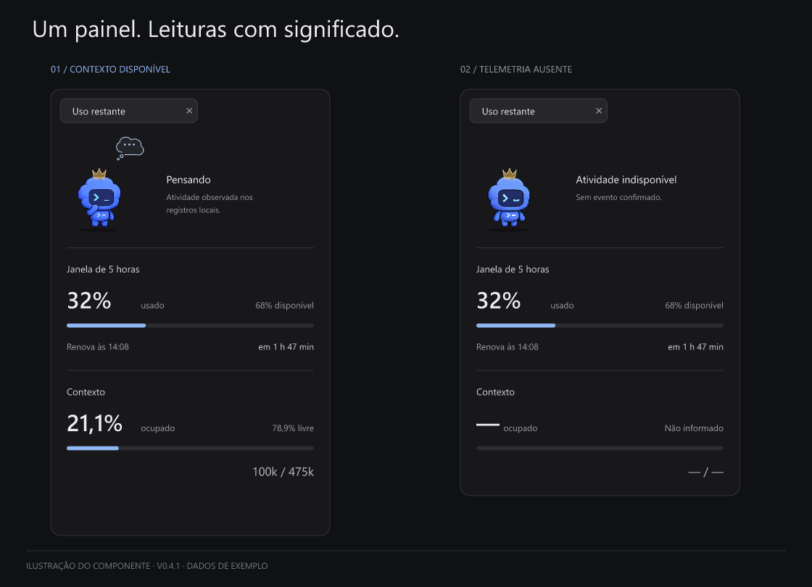
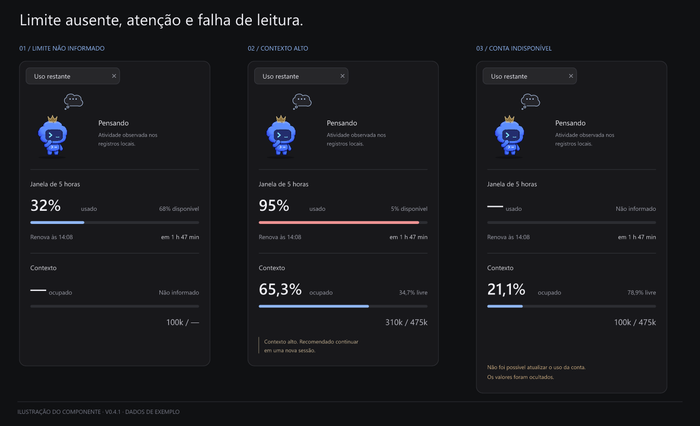
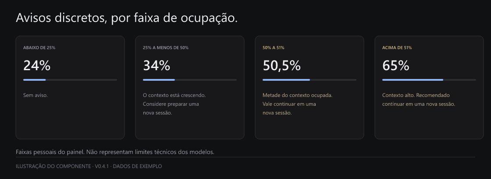
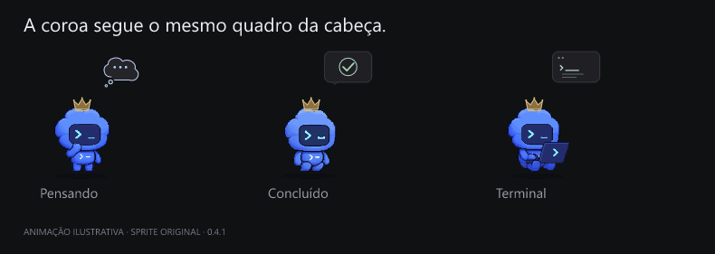
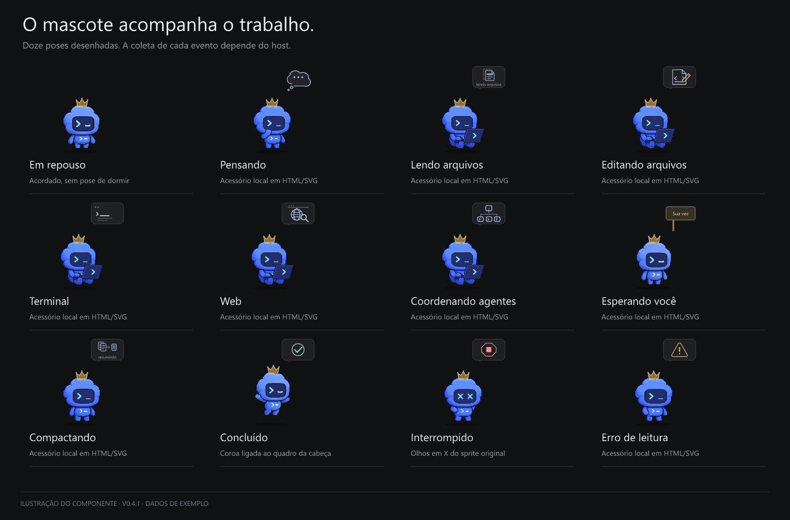
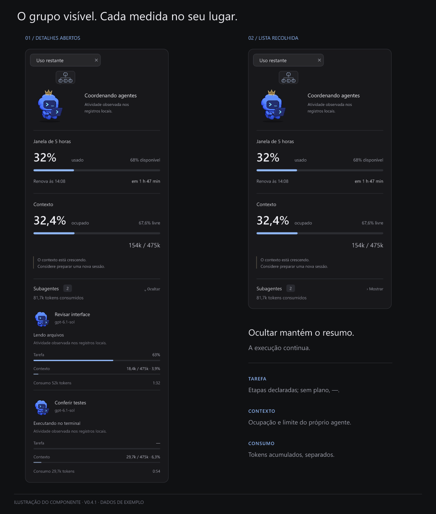
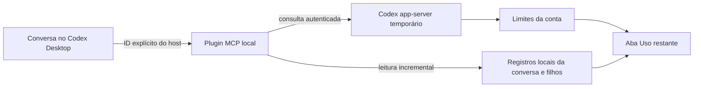

<div align="center">

# Codex Pulse

### Contexto, consumo e agentes. Na lateral da sua conversa.

<p>
  
  
  
  
</p>



**[Instalar](#instalação) · [Conhecer o painel](#o-painel-por-dentro) · [Ver as poses](#o-mascote-e-suas-poses) · [Consultar limitações](#o-que-a-versão-atual-entrega)**

</div>

O **Codex Pulse** é um plugin local para acompanhar a sua conversa no Codex Desktop. Ele reúne o consumo da janela de cinco horas, o contexto ocupado e os subagentes vinculados à conversa em um painel compacto, com o mascote original do Codex acompanhando a atividade observada.

O aplicativo inicia o componente local do plugin. Você abre a aba e acompanha o trabalho; não precisa subir um servidor, abrir um site ou executar o plugin manualmente.

> [!NOTE]
> **As imagens deste README são ilustrações geradas a partir do sprite, dos acessórios e das regras visuais da versão 0.4.1, com dados de exemplo.** Não são capturas de uma execução nem prova de integração de todos os estados. A [matriz de validação](docs/validation.md) registra o que foi conferido na lateral real e o que tem apenas cobertura automatizada.

## Por que usar

Durante uma tarefa longa, vale conseguir responder a três perguntas sem sair da conversa:

- **Quanto uso ainda tenho?** A janela de cinco horas mostra consumo, saldo, horário de renovação e contagem regressiva.
- **Quanto contexto esta conversa ocupa?** Uma barra separada mostra a ocupação atual e a leitura direta de tokens, como `100k / 475k`.
- **O que está acontecendo com os agentes?** O painel mostra os filhos dessa conversa, com contexto próprio, consumo acumulado e tempo de execução.

O mascote ajuda a perceber a atividade. Os números ajudam a decidir quando continuar, aguardar a renovação ou preparar uma conversa nova.

## O que a versão atual entrega

| Recurso | Comportamento na 0.4.1 |
|:--|:--|
| Aba da conversa | Recurso MCP embutido no painel lateral; o nome mostrado atualmente é **Uso restante**. |
| Janela de cinco horas | Consulta real da conta autenticada pelo Codex app-server. |
| Contexto | Leitura dos registros locais da conversa identificada explicitamente pelo host. Integração experimental. |
| Limite do modelo | Usa a janela informada na leitura; não depende de uma tabela fixa de modelos. |
| Mascote | Sprite original, coroa no coordenador e acessórios de atividade. A coroa acompanha a cabeça quadro a quadro. |
| Subagentes | Filhos diretos da conversa e da mesma sessão, com métricas próprias. |
| Progresso da tarefa | Só aparece em percentual quando há etapas registradas. Sem etapas: `—`. |
| Ocultar / Mostrar | Recolhe os detalhes dos agentes e mantém o resumo. |
| Atualização | Consulta automática, em geral a cada 15 segundos após a anterior terminar. |
| Movimento reduzido | Desativa as animações e mantém uma pose estática coerente. |
| Parar um agente | **Indisponível.** Esta versão não anuncia uma ferramenta de interrupção. |
| Handoff / abrir nova sessão | Não automatizados. Os avisos apenas sugerem preparar ou continuar uma nova conversa. |

**Consumo da conta, ocupação de contexto e progresso da tarefa são medidas diferentes.** O Pulse mantém as três separadas.

## O painel por dentro

<div align="center">
  
</div>

O Pulse tem **um painel com seções condicionais**, em vez de várias telas independentes.

| Região | O que você encontra |
|:--|:--|
| Atividade | Mascote principal com coroa, nome do estado e uma descrição breve da observação. |
| Janela de 5 horas | Percentual usado, percentual disponível, barra, renovação e tempo restante. |
| Contexto | Ocupação e espaço livre em percentual, barra própria e tokens alinhados à direita. |
| Aviso de contexto | Sugestão discreta que acompanha a faixa de ocupação. |
| Subagentes | Seção condicional, exibida quando existem filhos acompanhados ou resultados recentes. |
| Falha de leitura | Mensagem discreta quando necessário; dado ausente não se transforma em zero. |

### Janela de cinco horas

Esta medida pertence à **conta Codex** e é compartilhada entre conversas. Ela não representa a memória desta conversa.

Exemplo: `32% usado` e `68% disponível` dizem quanto da janela foi consumido. Abaixo da barra, `Renova às 14:08` e `em 1 h 47 min` mostram o horário e a contagem regressiva. O horário usa **America/Sao_Paulo** nesta versão.

- A leitura usa `account/rateLimits/read` da sessão local autenticada.
- O horário vem de um timestamp completo; uma mudança de dia não é tratada como um horário de hoje.
- Se o prazo chega ao fim antes da nova leitura, aparece **Aguardando renovação**. O painel não zera o consumo por conta própria.
- As barras ficam azuis no uso normal, mudam para atenção a partir de 75% e para perigo a partir de 90%.
- O limite semanal não faz parte do painel.

### Contexto da conversa

O formato é direto: **usado / limite informado**. Em `100k / 475k`, a primeira parte é a ocupação observada depois da resposta mais recente e a segunda é a janela efetivamente informada para aquela leitura.

`475k` é um exemplo observado durante os testes, **não um limite atribuído a todos os modelos**. O mesmo vale para os outros valores das imagens.

| Situação | Como o painel responde |
|:--|:--|
| Uso e limite conhecidos | Mostra tokens, percentual ocupado/livre e barra. |
| Tokens conhecidos, limite ausente | Mostra, por exemplo, `100k / —`, sem percentual presumido. |
| Nenhuma leitura confiável | Mostra `— / —` e indica indisponibilidade. |
| Troca de modelo | Invalida a amostra antiga até conseguir correlacionar a nova leitura. |
| Compactação registrada | Descarta a ocupação anterior e aceita uma nova leitura menor. |
| Início de turno sem resposta própria | Pode manter os campos indisponíveis até a primeira amostra atribuída ao turno. |

O uso acumulado de toda a sessão **não entra na barra principal de contexto**. Uma compactação também não renova a janela de cinco horas.

<div align="center">
  
</div>

### Avisos de contexto

<div align="center">
  
</div>

| Ocupação, antes de arredondar | Mensagem |
|:--|:--|
| Abaixo de 25% | Nenhum aviso. |
| De 25% até menos de 50% | “O contexto está crescendo. Considere preparar uma nova sessão.” |
| De 50% até 51%, inclusive | “Metade do contexto ocupada. Vale continuar em uma nova sessão.” |
| Acima de 51% | “Contexto alto. Recomendado continuar em uma nova sessão.” |

São faixas escolhidas para este painel. **Não são limites técnicos dos modelos.** Não há popup, som ou solicitação automática de handoff. Se a ocupação diminuir depois de uma compactação, o aviso acompanha a faixa nova.

## O mascote e suas poses

<div align="center">
  
</div>

O coordenador usa uma coroa discreta. Os subagentes usam a mesma cor e aparecem sem coroa. Os balões são pequenos acessórios em HTML/SVG; o desenho do personagem foi preservado.

<div align="center">
  
</div>

**Uma pose disponível no desenho não garante que o coletor atual observe o evento correspondente em todo ambiente.** O painel usa a atividade registrada, sem ciclos aleatórios. A consulta do saldo da conta não muda a pose.

| Pose | Sinal e situação na integração atual |
|:--|:--|
| Pensando | Raciocínio registrado ou retomada depois de uma ferramenta. Conferido na lateral. |
| Lendo arquivos | Ferramenta de leitura reconhecida. A cobertura depende do nome e do formato registrado. |
| Editando arquivos | Alteração de arquivo ou `apply_patch` reconhecido. |
| Terminal | Execução de comando reconhecida; algumas chamadas de orquestração são classificadas pelo conjunto de ferramentas. |
| Web | Pesquisa web reconhecida. Ferramentas desconhecidas não recebem uma atividade inventada. |
| Coordenando agentes | Chamada de colaboração reconhecida no registro. |
| Esperando você | Solicitação de resposta reconhecida. Não é deduzida apenas porque a execução está silenciosa. |
| Compactando | Pose desenhada; a coleta atual invalida contexto após compactação, mas não garante capturar o estado intermediário. |
| Concluído | Término atribuído ao turno. Um estado breve pode passar entre duas consultas. |
| Interrompido | Aborto atribuído ao turno. Usa os olhos em X do sprite original. Não significa que o Pulse tenha feito a interrupção. |
| Erro | Pose disponível. Um erro recuperável isolado não é tratado como término definitivo; pode aparecer como atividade indisponível. |
| Em repouso | Pose disponível e acordada. O coletor atual não usa ausência de evento para afirmar repouso. |

Quando não há confirmação recente ou a ferramenta não é reconhecida, o personagem fica estático e a interface mostra **Atividade indisponível**. Isso preserva a diferença entre silêncio e um estado conhecido.

## Subagentes, um por um

<div align="center">
  
</div>

A seção fica **abaixo do contexto**. Outras conversas abertas não entram nela: o vínculo exige **parentesco direto com a conversa atual e a mesma sessão**.

| Campo | Significado |
|:--|:--|
| Nome | Identificação do agente, obtida do caminho registrado. Nomes longos são abreviados visualmente. |
| Modelo | Modelo informado no contexto de turno daquele agente; pode estar indisponível. |
| Mini Codex | Pose própria, sem coroa. |
| Atividade / descrição | Observação disponível nos registros. Nesta versão, o alvo detalhado de cada ferramenta não é garantido. |
| Tarefa | Percentual baseado em etapas declaradas; `—` quando elas não existem. |
| Contexto | Tokens e limite daquele agente, sem somar à barra do coordenador. |
| Consumo | Total acumulado atribuído ao agente; inclui tokens de entrada em cache. Não é preço em dinheiro. |
| Tempo | Tempo desde o início observado; congela em término confirmado. |

### Progresso não é contexto

As etapas concluídas valem `1`, as etapas em andamento valem `0,5` e as pendentes valem `0`. A interface aceita essas etapas quando o coletor as entrega. Antes do resultado, o valor fica em no máximo `99%`; com o resultado confirmado, chega a `100%`.

O suporte a planos depende dos eventos persistidos. Não existe uma estimativa baseada em tempo, tokens ou quantidade de mensagens. Durante o teste real, os agentes sem etapas apareceram corretamente com `—`.

### Ocultar, terminar e interromper

- **Ocultar** recolhe a lista e mantém o resumo de ativos e consumo. **Mostrar** restaura os detalhes. Os agentes continuam trabalhando.
- Resultados confirmados têm uma janela de retenção de **seis segundos a partir do término registrado**.
- Como a coleta usa consultas de cerca de 15 segundos, um resultado pode encerrar e expirar entre duas leituras. A pose final pode não aparecer.
- Sem agentes ativos nem resultados recentes, a seção desaparece completamente.
- **Não há botão Parar habilitado na versão atual.** Interrupções externas podem ser observadas, mas o plugin não interrompe agentes, o coordenador ou outras conversas.

## Instalação

### 1. Confira os requisitos

| Requisito | Por quê |
|:--|:--|
| Codex Desktop com suporte a plugins e abas MCP | A interface precisa do host desktop para abrir ao lado da conversa. |
| Codex CLI no `PATH` | O plugin consulta a conta pelo comando `codex app-server`. A CLI 0.163.0 foi usada na validação. |
| Node.js 22 ou superior | Runtime recomendado; a implementação foi validada com Node 22.21.1. |
| Conta ChatGPT autenticada no Codex | Fonte dos limites da conta. Não é necessária uma chave de API adicional para o plugin. |
| Mesmo ambiente local do desktop | Os registros da conversa precisam estar acessíveis àquele processo. |

**Windows é o ambiente validado.** macOS, Linux, WSL e ambientes remotos não foram certificados por estes testes. A interface não foi validada no ChatGPT web ou como HUD de terminal.

No terminal que compartilha o ambiente do aplicativo:

```powershell
node --version
codex --version
```

Se você ainda não está autenticado no Codex:

```powershell
codex login
```

### 2. Adicione o marketplace e instale

```powershell
codex plugin marketplace add ba-lison/codex-pulse
codex plugin add usage-panel@codex-pulse
```

O projeto se chama **Codex Pulse**. O identificador técnico preservado do plugin é `usage-panel`, e o marketplace deste repositório é `codex-pulse`.

Confira a instalação:

```powershell
codex plugin list --json
```

Procure `usage-panel@codex-pulse`, versão `0.4.1`, instalado e habilitado. O resultado confirma a instalação no disco; o próximo passo carrega a versão no desktop.

### 3. Reabra o aplicativo e abra a aba

1. **Encerre completamente o Codex Desktop e abra de novo.**
2. Volte à conversa que deseja acompanhar.
3. Abra o seletor de abas/conteúdo lateral da conversa e escolha **Uso restante**. O local exato desse seletor depende da versão do aplicativo.
4. Aguarde a primeira leitura. O contexto pode permanecer indisponível até haver uma resposta própria da conversa com telemetria correlacionada.

O servidor MCP será iniciado pelo host. Não execute `server/index.mjs` manualmente para usar o painel.

> [!IMPORTANT]
> Fechar e reabrir só a aba pode manter um servidor antigo em memória. Isso foi observado nos testes: a CLI mostrava a versão nova, enquanto a lateral ainda usava a antiga. O reinício completo resolveu o carregamento.

<details>
<summary><strong>Instalar a partir de um clone local</strong></summary>

```powershell
git clone https://github.com/ba-lison/codex-pulse.git
cd codex-pulse
codex plugin marketplace add .
codex plugin add usage-panel@codex-pulse
```

Depois, encerre e reabra o desktop. Para usar o plugin, **não é necessário executar `npm install`**: as dependências npm deste repositório servem apenas para gerar as imagens da documentação.

</details>

### Atualizar

Para uma instalação pelo GitHub:

```powershell
codex plugin marketplace upgrade codex-pulse
codex plugin add usage-panel@codex-pulse
```

Reabra completamente o desktop. Para uma cópia de desenvolvimento, atualize seu clone com `git pull` antes de instalar a versão nova.

Evite reinstalar uma versão idêntica cujo cache esteja sendo usado. No desenvolvimento, mudanças de código devem receber uma nova versão. Não edite diretamente a pasta de cache do aplicativo.

### Remover

```powershell
codex plugin remove usage-panel@codex-pulse
```

Opcionalmente, remova também o marketplace:

```powershell
codex plugin marketplace remove codex-pulse
```

O diretório local de diagnóstico é separado e não é limpo por uma rotina própria do Pulse.

## Como os dados chegam ao painel



Há duas fontes distintas:

1. **Conta:** uma consulta curta a um app-server local lê os limites. Requisições simultâneas no mesmo servidor compartilham uma consulta; o resultado é mantido por até 15 segundos.
2. **Conversa:** os registros locais são lidos incrementalmente, com verificação do ID e da atribuição dos eventos. Esse caminho é uma integração experimental; não é uma assinatura do fluxo ativo do desktop.

O ID não é escolhido pela conversa mais recente, pela pasta aberta ou por um ID gravado no código. Sem metadado explícito do host, o saldo da conta pode continuar disponível enquanto o contexto permanece desconhecido.

Para entender a correlação de modelo, tokens, compactação e herança de subagentes, veja a [arquitetura técnica](docs/architecture.md).

## Atualização, recursos e privacidade

- O painel consulta novamente depois que a leitura anterior termina; não empilha consultas.
- A aba oculta por `document.hidden` suspende os timers. Ao voltar, a interface recupera o estado.
- Ao encerrar o recurso com `pagehide`, os timers e listeners são descartados.
- Animações usam o sprite e SVGs locais. Não precisam de rede nem de turnos do modelo.
- O plugin não inicia conversas de IA para consultar métricas ou desenhar o mascote.
- A consulta da conta passa pelo app-server autenticado do Codex. O projeto não exige um servidor próprio de hospedagem.
- Os registros da conversa são lidos localmente. O código do plugin não os envia a um backend do Codex Pulse.
- O diagnóstico guarda versão, PID, chaves de metadados e ID resolvido da conversa em `<CODEX_HOME>/usage-panel/diagnostics.jsonl`. Esse ID pode identificar uma conversa; revise o arquivo antes de compartilhar trechos.

## Perguntas frequentes

<details>
<summary><strong>O contexto está em “— / —”. O que fazer?</strong></summary>

Espere uma resposta própria do modelo e a próxima consulta. O coletor exige identidade e atribuição coerentes; registros antigos, uma conversa remota ou um host que não fornece o ID podem impedir essa leitura. O painel não preenche valores com uma estimativa. Verifique também se o desktop e a CLI compartilham o mesmo ambiente local e `CODEX_HOME`.

</details>

<details>
<summary><strong>A conta funciona, mas a atividade está indisponível. É um erro?</strong></summary>

As fontes são independentes. A conta pode responder mesmo sem eventos recentes ou reconhecidos da conversa. Depois de 60 segundos sem confirmação de atividade em uma execução ainda aberta, o coletor deixa de afirmar o estado. Isso não prova que o agente esteja parado.

</details>

<details>
<summary><strong>O mascote fica sempre em Pensando, mesmo usando ferramentas?</strong></summary>

Uma atividade curta pode começar e terminar entre duas consultas. Além disso, o formato dos eventos varia com o host. A galeria documenta as poses disponíveis; ela não significa que todos os eventos apareçam em todas as versões do Codex.

</details>

<details>
<summary><strong>O Pulse não mostrou um subagente.</strong></summary>

A versão atual exige um filho direto, a mesma sessão e um registro local verificável. Um filho recém-criado pode ainda não ter amostra própria. Um resultado também pode expirar antes da próxima consulta. Conversas independentes e descendentes mais profundos não são agregados nesta versão.

</details>

<details>
<summary><strong>Por que a tarefa mostra “—”, mas o contexto já tem percentual?</strong></summary>

O contexto é uma contagem de tokens. A tarefa depende de etapas registradas pelo agente. Uma métrica não revela a outra; sem plano, o Pulse não estima progresso.

</details>

<details>
<summary><strong>Posso parar um agente ou compactar a conversa pelo painel?</strong></summary>

Não na 0.4.1. O plugin é somente leitura. Não há controle de interrupção, compactação manual, geração de handoff ou criação de sessão. Os projetos Claude MOD relacionados têm integrações próprias; suas funcionalidades não são automaticamente capacidades deste plugin.

</details>

<details>
<summary><strong>Atualizei, mas a interface antiga continua aberta.</strong></summary>

Confirme a versão com `codex plugin list --json` e encerre completamente o aplicativo antes de abrir outra vez. Se já existia uma instalação pessoal como `usage-panel@alison-personal-plugins`, não mantenha duas cópias habilitadas ao testar a distribuição deste repositório. Faça essa troca conscientemente; os identificadores de marketplace são diferentes.

</details>

<details>
<summary><strong>O Node ou o Codex não foi encontrado pelo plugin.</strong></summary>

Confira `node --version` e `codex --version` no ambiente local e reinicie o desktop depois de instalar ou ajustar o `PATH`. O aplicativo pode ter herdado um ambiente anterior. Não substitua o comando por uma URL ou um servidor externo para contornar o problema.

</details>

<details>
<summary><strong>Uma falha de leitura transforma os valores em zero?</strong></summary>

Não. Valores ausentes usam `null` e aparecem como indisponíveis. Uma falha de transporte pode preservar a última leitura da conta com aviso; a telemetria da conversa é descartada para não parecer atual. Se a consulta da conta falhar mas a leitura local da conversa funcionar, o contexto válido continua disponível.

</details>

## Desenvolver e verificar

```text
codex-pulse/
├── .agents/plugins/marketplace.json   # catálogo instalável
├── plugins/usage-panel/
│   ├── plugin.json                  # identidade e versão do plugin
│   ├── mcp.json                     # início por Node + stdio
│   ├── server/                      # MCP, conta e leitura dos registros
│   └── ui/                          # HTML, runtime, sprite e testes
├── docs/
│   ├── assets/                      # imagens deste README
│   ├── tools/render-assets.mjs       # gerador reproduzível
│   ├── architecture.md              # contratos e origem das métricas
│   └── validation.md                # evidências e limites dos testes
└── README.md
```

O runtime usa módulos nativos do Node. Para editar a interface:

```powershell
node plugins/usage-panel/ui/build-ui.mjs
node --check plugins/usage-panel/server/index.mjs
node --test plugins/usage-panel/server/*.test.mjs plugins/usage-panel/ui/panel-ui.test.mjs
```

Edite `panel-runtime.js` e rode `build-ui.mjs` para incorporar o código ao recurso autocontido `main.html`. O sprite não precisa ser modificado para ajustar acessórios ou estados.

Para reconstruir as ilustrações:

```powershell
npm ci
npm run docs:assets
```

O gerador usa os estados, o sprite e os acessórios do plugin. Os exemplos de dados são definidos somente na documentação. Não são instalados como uma fonte alternativa de métricas.

### O que foi testado

**35 testes automatizados** cobrem normalização da conta, identidade e herança de conversas, limites ausentes, troca de modelo, compactação, buffers parciais, métricas dos agentes, retenção, mensagens do bridge, ciclo de vida da UI e movimento da coroa.

Na lateral real foram conferidos: versão carregada, vínculo com a conversa, conta e contexto atualizando, grupo de dois agentes, Ocultar/Mostrar e remoção após término. A largura de 319 px foi verificada sem overflow horizontal. O ajuste visual 0.4.1 tem testes automatizados; sua aparência final no host ainda não recebeu a mesma validação registrada da 0.4.0.

Os comandos da distribuição deste repositório são verificados em um ambiente de configuração isolado. Veja os detalhes e as distinções em [docs/validation.md](docs/validation.md).

## Limites conhecidos

- Dependência de metadados e formatos locais que podem mudar entre versões do Codex.
- Leitura por consulta, com atraso de persistência e amostragem; não é acompanhamento contínuo de todos os eventos.
- Conclusões de seis segundos podem passar entre consultas de 15 segundos.
- Modelo informado no contexto do turno não comprova sozinho todo roteamento remoto de execução.
- Progresso, alvo detalhado e algumas poses dependem do que for efetivamente registrado.
- Sem controle de agentes, compactação manual, handoff, histórico de custos ou agregação de outras sessões.
- Validação concentrada em Windows. As demais plataformas permanecem sem confirmação.

## Créditos e projetos relacionados

Criado por [Alison Cruz](https://github.com/ba-lison).

- [Claude MOD — usage-hud](https://github.com/ba-lison/Claude-MOD-usage-hud): referência de apresentação, consumo e acompanhamento de atividade no Claude Code.
- [Claude MOD — tripulação](https://github.com/ba-lison/Claude-MOD-tripulacao): referência de acompanhamento individual de subagentes e separação de métricas.
- [Documentação oficial de plugins](https://developers.openai.com/plugins/build/plugins) e [comandos de desenvolvimento](https://learn.chatgpt.com/docs/developer-commands): empacotamento e comandos de marketplace.

O mascote original do Codex é um recurso visual da OpenAI. Este projeto é uma integração independente. Consulte [NOTICE.md](NOTICE.md) para a origem dos recursos; o repositório ainda não declara uma licença pública para o conjunto.
